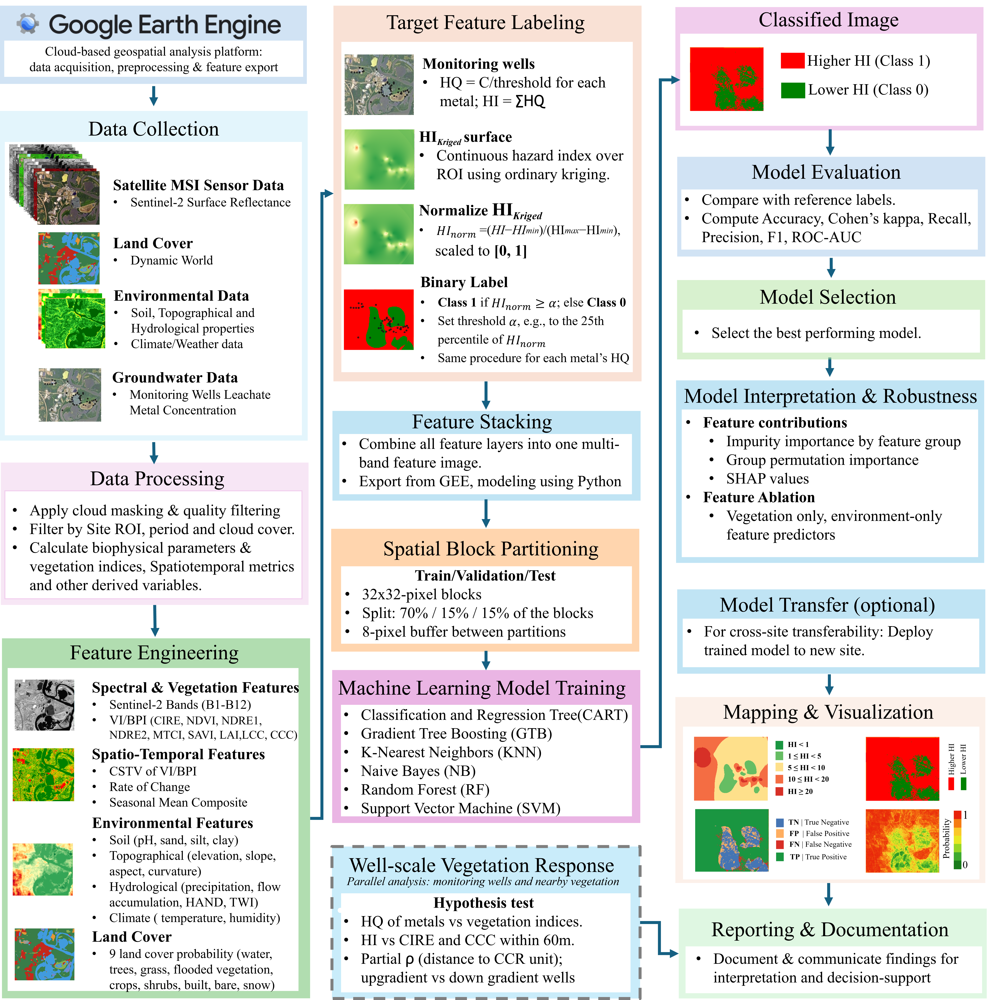

# An Integrated Remote Sensing and Machine Learning Framework for Mapping Hazard Associated with Leached Metals

Code for the paper *An Integrated Remote Sensing and Machine Learning Framework for Mapping Hazard Associated with
Leached Metals* (Karim, Nojabaei and Foroutan, in review).



## Overview

**Problem.** Metals leached from coal combustion residual (CCR) disposal units can contaminate groundwater for decades.
Regulatory monitoring relies on sparse wells that sample discrete points at infrequent intervals, so the extent of the
hazard between wells is largely unknown.

**Approach.** The framework converts groundwater monitoring data into a spatial hazard reference and relates it to
public satellite and geospatial data:

1. Groundwater concentrations are standardized against constituent-specific reference thresholds as Hazard Quotients
   (HQ) and summed into a composite Hazard Index (HI) at each well. The well HI is kriged, normalized and split at its
   25th percentile into a lower- and a higher-HI class.
2. Predictors are extracted in Google Earth Engine:
   - Sentinel-2 summer medians (2019–2025): 12 bands, nine vegetation indices and biophysical parameters;
   - spatio-temporal vegetation metrics (CSTV, Sen's-slope rate of change);
   - topographic (SRTM), climatic (MODIS, NLDAS, GLDAS, CHIRPS), soil (SoilGrids), hydrological (MERIT Hydro:
     upstream area, HAND, TWI) and Dynamic World land-cover variables.
3. Six classifiers (CART, Random Forest, Gradient Tree Boosting, SVM, k-NN, Naïve Bayes) are trained and tested on
   spatially separated blocks with a buffer. The evaluation adds:
   - majority-class baselines;
   - feature importance and SHAP;
   - feature-set ablation and location-only baselines;
   - label sensitivity;
   - constituent-level HQ models;
   - leave-one-site-out transfer.
4. At the well scale, the HI of each well is related to the vegetation indices averaged within 60 m of the well
   (Spearman and partial Spearman correlation, Theil–Sen trend), with a land-cover diagnostic.

**Contribution.** The framework is an open, reproducible workflow from public satellite data and well records to hazard
labels, trained models and hazard maps. Its evaluation separates genuine predictive skill from spatial interpolation
and class imbalance.

## Repository structure

```
leached-metal-hazard-rs-ml/
├── src/
│   ├── hazard_ml_gee.py         # Step 0: Earth Engine feature stacks, kriged HI, labels and risk classes (GeoTIFF export)
│   └── hazard_ml.py             # Steps 1-10: models, figures and tables on a local computer
├── notebooks/
│   └── hazard_ml.ipynb          # the same pipeline as a step-by-step notebook (one cell per step)
├── data/                        # inputs: download from Zenodo (see data/README.md)
│   ├── features_labels/
│   └── well_maps/
├── results/                     # outputs are written here
├── docs/figures/framework.png
├── requirements.txt
├── environment.yml
├── CITATION.cff
└── LICENSE
```

## Installation

```bash
git clone https://github.com/salmansust/hazard_rs_ml.git
cd hazard_rs_ml
conda env create -f environment.yml && conda activate leached-metal-hazard
# or: pip install -r requirements.txt
```

Step 0 also needs an Earth Engine account and a registered Google Cloud project
(`earthengine authenticate`, then set `EE_PROJECT` in `src/hazard_ml_gee.py`).

## Usage

**Step 0: export the features (Earth Engine).** Edit the settings block of `src/hazard_ml_gee.py`:
- `EE_PROJECT`;
- the site ROIs;
- the well HI composite of each site, either as an Earth Engine asset or through `WELLS_FROM_CSV`;
- the kriging variograms.

Then run it:

```bash
python src/hazard_ml_gee.py
```

Copy the exported `<site>_Features.tif`, `<site>_Label.tif` and `<site>_HI.tif` to `data/features_labels/`.

**Steps 1–10: models, figures and tables (local).** Edit the settings block of `src/hazard_ml.py` (or the
*Settings* cell of the notebook), then run one of:

```bash
python src/hazard_ml.py                 # all steps
jupyter lab notebooks/hazard_ml.ipynb   # step by step
```

Every step saves a checkpoint in `results/checkpoints/` and is restored on a rerun when its settings and inputs are
unchanged (`CHECKPOINT = "auto"`).

| Step | Function | Main outputs (in `results/`) |
|---|---|---|
| 1 | `step_load` | site stacks, labels, wells, CCR units |
| 2 | `step_feature_maps` | `feature_maps/`, `feature_groups/` (every predictor band) |
| 3 | `step_models` | six classifiers × three seeds on spatial blocks; site maps, confusion matrices, model comparison, feature-group importance, Table 1 |
| 3b | `step_ablation` | vegetation-only, environment-only and location-only models (Table 10, Fig. 11) |
| 3c | `step_sensitivity` | label threshold (25th/33rd/50th percentile) and ≤ 250 m from a well (Table 11) |
| 4 | `step_metal_hq` | constituent-level HQ classes and RF models (Figs 2–4, Table 3) |
| 5 | `step_well_maps` | well HI maps (Fig. 5) |
| 6 | `step_index_rows` | vegetation index, CSTV and rate-of-change maps per site (Fig. 6) |
| 7 | `step_shap` | SHAP for Random Forest on held-out test pixels (Figs 7–8) |
| 8 | `step_hivi` | well HI vs CIRE and CCC (Fig. 12), vs all nine indices, land-cover diagnostic; 60 m buffer (`hi_vegetation/`) |
| 9 | `step_loso` | leave-one-site-out transfer (Table 9, Figs 9–10) |
| 10 | `step_summary` | Word and LaTeX (booktabs) tables, summary |

Figure and table numbers in the output names refer to the pipeline, not necessarily to the paper.

## Main settings

| Setting | Default | Meaning |
|---|---|---|
| `ALPHA_PERCENTILE` | 25 | class 0 = lowest 25% of the normalized HI |
| `BLOCK_PX`, `SPLIT_FRAC`, `BUFFER_PX` | 32, (0.70, 0.15, 0.15), 8 | spatial block size, train/validation/test shares, buffer between partitions (pixels) |
| `SEEDS` | 42, 43, 44 | repetitions of every model |
| `HIVI_BUFFER_M` | 60 | buffer for the HI–vegetation analyses (m) |
| `HIVI_INDICES`, `HIVI_ALL_EXCLUDE` | CIRE, CCC; none | indices of Fig. 12; indices left out of the all-indices figure |
| `FONT_ALL`, `FIG_FONTS`, `SITE_COLORS` | — | fonts and colors of every figure |

## Data

The data used in the paper are available on Zenodo:

> Karim, S. (2026). *Multisource remote sensing dataset for leached metal hazard mapping at four coal combustion residual sites in Virginia, USA (2019–2025)* (Version 1.0) [Dataset]. Zenodo. [https://doi.org/10.5281/zenodo.23823223](https://doi.org/10.5281/zenodo.23823223)

Download the dataset and place its files in `data/` as described in `data/README.md`. The predictors can also be
regenerated from public Earth Engine datasets with `src/hazard_ml_gee.py`.

## Citation

If you use this code, please cite the paper (see `CITATION.cff`):

> Karim, S., Nojabaei, B., Foroutan, H. An Integrated Remote Sensing and Machine Learning Framework for Mapping Hazard
> Associated with Leached Metals. (Preprint) https://doi.org/10.48550/arXiv.2611.32505

If you use the data, please also cite the dataset:

> Karim, S. (2026). *Multisource remote sensing dataset for leached metal hazard mapping at four coal combustion residual sites in Virginia, USA (2019–2025)* (Version 1.0) [Dataset]. Zenodo. [https://doi.org/10.5281/zenodo.23823223](https://doi.org/10.5281/zenodo.23823223)

## Acknowledgments

This work was supported by the U.S. Department of Energy, National Energy Technology Laboratory, under Award Number
DE-FE0032184.

## License

MIT License (see `LICENSE`).
